# Business calendar and combined phone acceptance

Ticket: [12 — Business calendar phone demo](../../.scratch/bookme-website-refresh/issues/12-business-calendar-phone-demo.md).
This is the combined evidence for the website with both phones and the web-app
entry points. The [earlier client report](../booking-demo/README.md) records the
client app reference capture in detail. Final quality measurements are recorded
below; this report does not claim a deployment or a remote CI run.

## Fixed example and app comparison

Today is **15 October 2026**, in **Europe/Chisinau**. All names and appointments
are fictional. The shared appointment is Ana Demo's confirmed **Manicure /
Manichiură** with **Mara Luca**, at **Studio Luma**, **14:30**, **1 h**, **300 MDL**.
The client and Business examples share these constants at build time. They do
not communicate or create appointments; the Business caption explicitly says
they are not live-synced.

| Period | Appointments shown |
| --- | --- |
| Today | Ana Demo, 15 October, 14:30, manicure, 1 h, 300 MDL |
| Week | Ana plus Daria Demo, 16 October, 10:00, haircut, 30 min, 200 MDL |
| Month | Ana and Daria plus Irina Demo, 22 October, 11:00, pedicure, 45 min, 250 MDL |
| Search `Ana Demo` within Month | Ana's card only |
| Clear search | All three month appointments |

Every appointment is with Mara Luca and has Confirmed / Confirmată status.
The real app filters by case-insensitive substring; the fixture names avoid an
accidental second match. Dates fall within the real app's Monday–Sunday week
and calendar-month rules.

The local Business app was run on 18 September 2026 from mobile commit
`bcbc1c6d44b49311da2a345ac69af79f8d1e4e9f`, using actual Angular/Ionic screens,
a synthetic in-memory session, a fixed browser date and intercepted fixtures.
Every non-local request was fulfilled or aborted. No real account, API booking,
message or device permission was used, and the mobile source was unchanged.
The client references were captured from that same mobile commit on the same
date in ticket 11. Website screenshots here were refreshed on the final build.

The relevant mobile sources are under `projects/salon/src/app/shared/appointments/`:
`appointments-calendar-shell/`, `appointment-card/`, and
`appointments-calendar.util.ts`. RO/EN labels were checked against
`src/app/i18n/translations/{ro,en}.ts`; the admin shell supplies the tab navigation.

### Business: current app beside the website

| State | Current local app | Website phone |
| --- | --- | --- |
| Today | 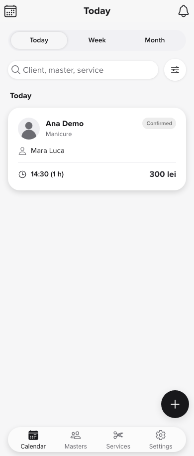 | 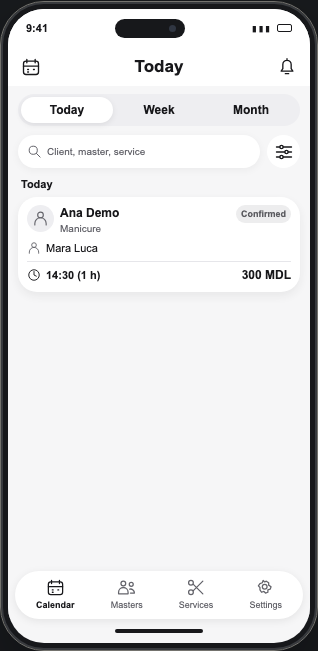 |
| Week | 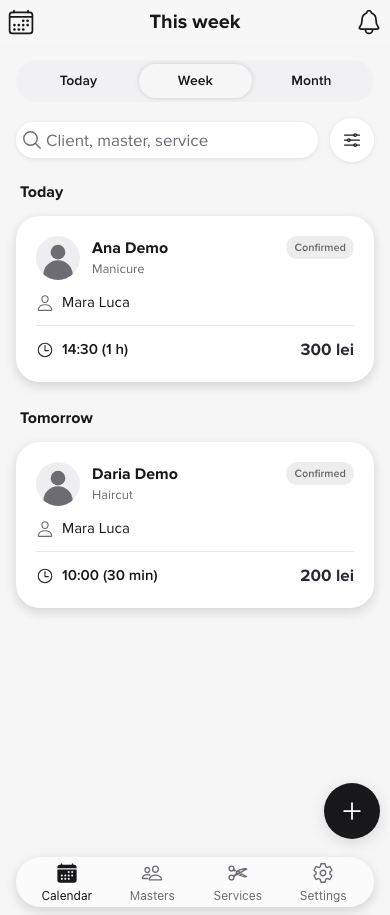 | 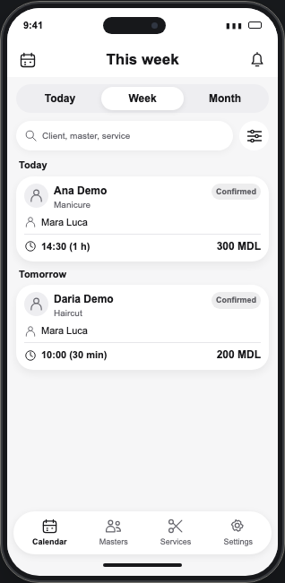 |
| Month | 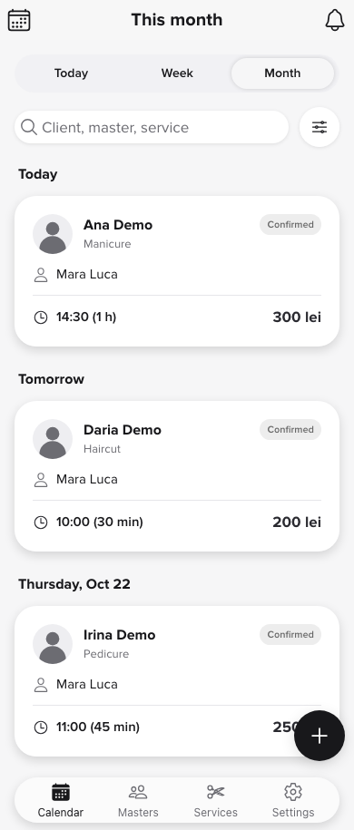 |  |
| Client search | 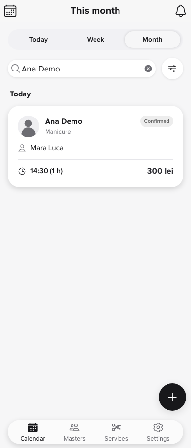 | 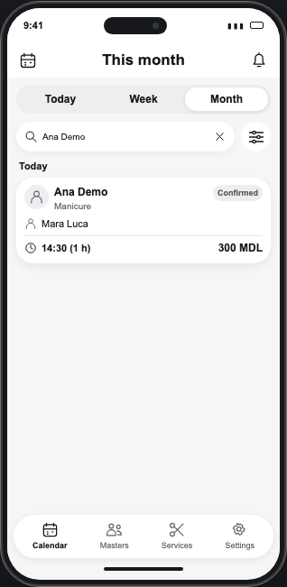 |
| Card details | 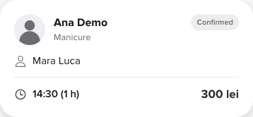 | 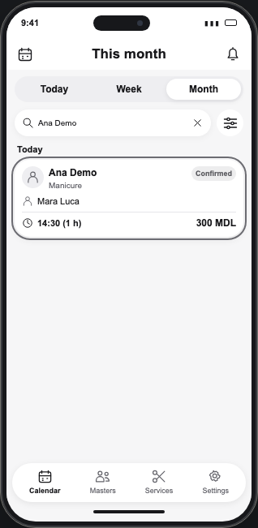 |
| Search cleared |  | 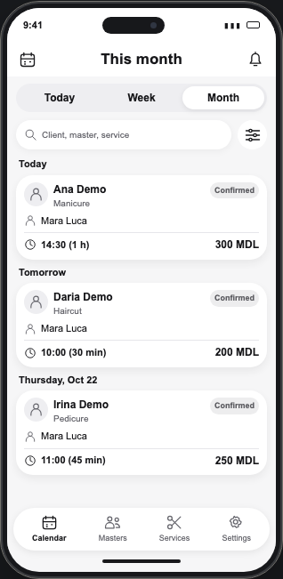 |

### Client: current app beside the final website

| State | Current local app | Website phone |
| --- | --- | --- |
| Search | 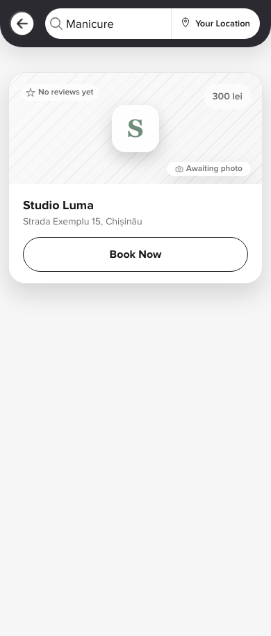 | 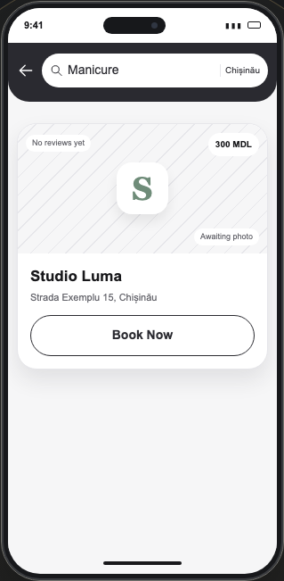 |
| Booking form | 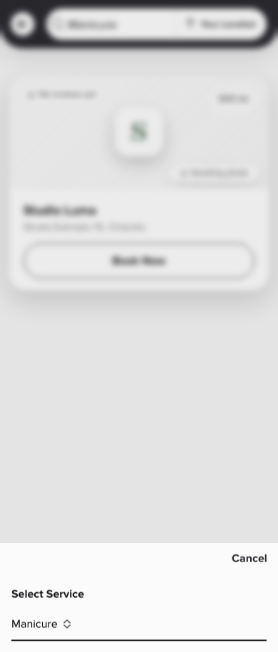 | 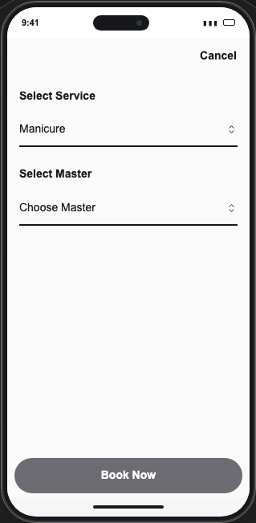 |
| Service | 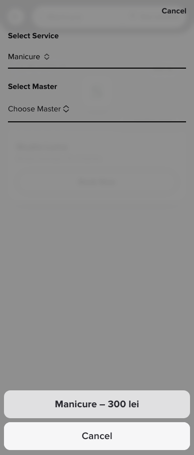 | 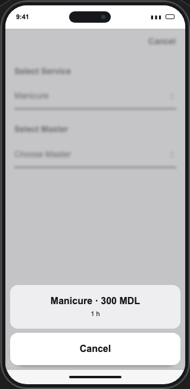 |
| Specialist |  | 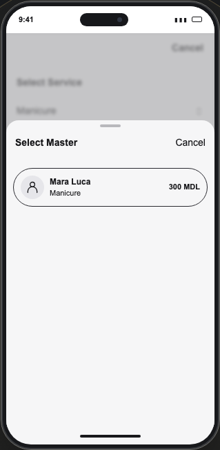 |
| Date and time | 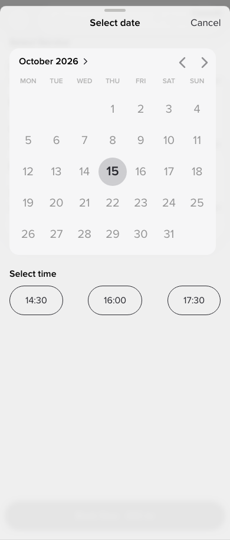 | 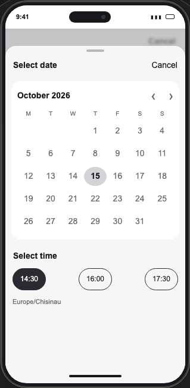 |
| Confirmation | 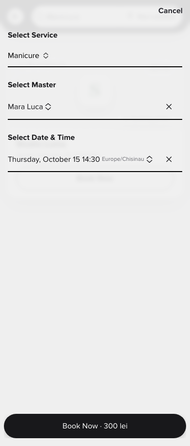 | 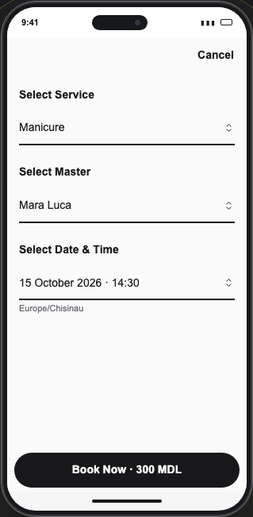 |
| Result | 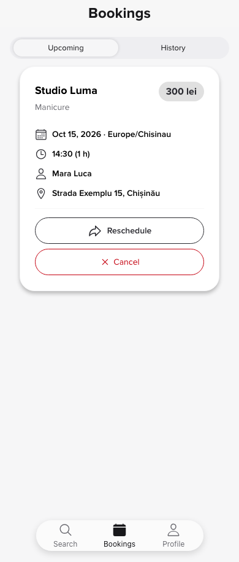 | 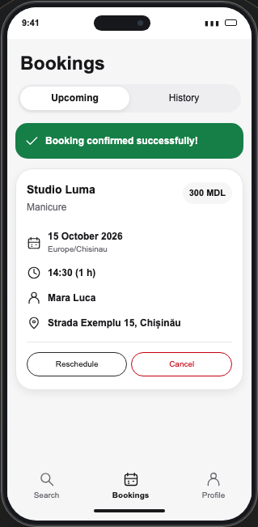 |

Presentation adjustments: spacing and type are compressed to fit a marketing
phone, with system sans-serif instead of the app's font. MDL is explicit instead
of the app's `lei`. Business retains light surfaces, rounded date-grouped cards,
gray confirmed badges, period/search controls, outline icons and bottom tabs.
The silhouette is locally authored SVG, not a real person's photo. Calendar,
notification, filter and tab icons are decorative; the unrelated create action
is omitted. Card details are already visible in the real app: frame 5 adds a
presentation outline, without inventing a details modal or editing action.
There are no specialist columns or drag-and-drop.

The shared phone height is 650px (630px at narrow widths). Visual inspection
found that the old 590px narrow shell covered the third card footer; a failing
text-obstruction test reproduced it before this correction. Both phones were
recaptured and retested with the shared dimensions.

## Responsive and accessibility evidence

| Width | Business RO / EN | Client RO / EN |
| --- | --- | --- |
| 320px | [RO](website/business-ro-320-final.png) · [EN](website/business-en-320-final.png) | [RO](website/client-ro-320-final.png) · [EN](website/client-en-320-final.png) |
| 768px | [RO](website/business-ro-768-final.png) · [EN](website/business-en-768-final.png) | [RO](website/client-ro-768-final.png) · [EN](website/client-en-768-final.png) |
| 1440px sections | [RO](website/business-ro-1440-section.png) · [EN](website/business-en-1440-section.png) | [RO](website/client-ro-1440-section.png) · [EN](website/client-en-1440-section.png) |

The `website/` directory also contains every narrow frame in both languages,
every English desktop frame and complete 320px sections. These PNGs are evidence
only; none ships as a page asset. The existing client capture rights and
presentation notes apply. All new screen geometry is HTML/CSS/local SVG.

Business plays once for 15 seconds after 60% of the phone becomes visible:
Today → Week → Month → search → read details → clear. Frames dwell for
2.6/2.8/3.2/2.6/3.8 seconds with 280ms transitions. The result remains still.
The existing per-instance controller supplies pause/resume/replay, offscreen
and tab-visibility pauses, and preservation of manual pause. Reduced motion
uses static final content and optional manual Replay/Next step. A live preference
change stops playback; changing back does not auto-start. With JavaScript
disabled, the final calendar and native step disclosure work immediately.

The stable image description and ordered text steps expose the whole scenario
without announcing frame changes. Illustrated controls are not focusable inputs.
Both phones' accessibility trees are recorded for
[Business RO](website/business-accessibility-ro.txt),
[Business EN](website/business-accessibility-en.txt),
[client RO](website/client-accessibility-ro.txt), and
[client EN](website/client-accessibility-en.txt).

### Manual acceptance record

Tester: Codex. Date: 18 September 2026. Host: macOS 26.6.2; Chromium
153.0.8010.12. Build: website baseline `ae8452086159aa92a845f8737171c6bf5d5c6b5b`
plus this ticket's changes. Automated results below are distinct from human checks.

| Check | Result and limitation |
| --- | --- |
| App structure, labels, colors, icons, date/search transitions | Pass: local app captured with fixture data; screenshots and source compared with the website's key states. |
| Both languages and phone/desktop readability | Pass: screenshot inspection at 320/768/1440px; all card fields and captions visible after the overlap correction. |
| Contrast and decorative surfaces | Pass for visual inspection of both phones; neutral confirmed badge, dark text on light cards, visible external controls. Automated axe also checks every frame. |
| Screen-reader description | Pass for accessibility-tree inspection: fictional-data disclosure, stable localized scenario, full step list, no fake fields/live frame stream. Native VoiceOver pronunciation and interaction: **pending human review**. |
| Native keyboard-only walkthrough and unobscured focus | **Pending human review**. Browser tests exercise native Tab/Option-Tab/Enter/Space, target sizes, focus outline and obstruction separately. |
| Actual browser zoom to 400% | **Pending human review**. Automated 320px reflow and text-obstruction checks are not a manual zoom result. |
| OS reduced-motion toggle | **Pending human review**. Browser preference emulation from load and during playback passes separately. |
| Background tab | Controlled browser visibility events tested in all three engines, including manual-pause preservation. Native window/tab interaction has not been manually confirmed. |

The remaining manual checks and ticket 09's outstanding content approval remain
open. This report does not certify WCAG compliance or mark incomplete acceptance
as passed. Follow [the existing manual procedure](../../docs/quality-gates.md#manual-acceptance-record).

## Reproduction and final gates

Use the existing production quality harness, without a second test server or
weakened budgets. CI's `npm test` automatically includes both phone suites and
all eight pages' web-app links in Chromium, Firefox and WebKit, including explicit
normal-motion tests, reduced motion, and the three no-JavaScript projects.
The existing workflow retains reports, traces and failure screenshots for 14 days.

```sh
npm run check
npm run build
npm test -- tests/business-demo.spec.ts tests/booking-demo.spec.ts
npm test
npm run test:lighthouse
npm run package:site
```

`tests/business-demo.spec.ts` checks visible periods/search/card data, both-phone
independence, all playback controls, offscreen/hidden-tab behavior, keyboard and
focus, initial/paused/final axe scans plus every frame, static fallbacks, live
motion preference changes, text clipping/obstruction, API/permission isolation,
and FAQ/contact/navigation during normal playback. It uses public visible
states and a controlled browser clock, not animator internals. FormBold replies
are intercepted. The budget suite additionally requires zero executable JS on
all pages without demos.

The static fallback and sequence tests were each observed failing before their
implementation, then passing. All pre-existing site tests are retained. The
obsolete AppPreview illustration and its unused localized content were removed.

Capture the local app (sibling Salon server on 4201) and production website
(preview on 4328) with:

```sh
node scripts/capture-booking-reference.mjs --business
node scripts/capture-booking-demo.mjs --both
```

### Browser and asset results

`npm run check`: **0 errors, warnings or hints**. `npm run build`: **nine static
HTML pages**, including 404. Final `npm test`: **1,046 passed, 142 intentionally
skipped, zero failures/flaky results/retries**, in **156.5 seconds**.

| Project | Passed | Expected skips |
| --- | ---: | ---: |
| Chromium | 198 | 0 |
| Firefox | 190 | 8 |
| WebKit | 190 | 8 |
| Chromium mobile, no JS | 156 | 42 |
| Firefox mobile, no JS | 156 | 42 |
| WebKit mobile, no JS | 156 | 42 |

Skips are duplicate asset-budget measurements outside Chromium (40) and
JavaScript-dependent playback/axe/fetch checks in the no-JavaScript projects
(102). Static demo content, native disclosures, navigation, forms and reflow
remain tested without JavaScript. There are no disabled browser engines or
omitted indexable pages. Raw results: `reports/playwright.json`,
`reports/full-suite.log` and `playwright-report/index.html`.

| Pages | JavaScript gzip | CSS gzip | Limits |
| --- | ---: | ---: | --- |
| `/`, `/en/` — each, with both phones | 1,409 B | 6,608 B | 20,000 B JS / 40,000 B CSS |
| Six legal pages — each | 0 B | 2,179 B | Same |

These are gzip level-9 measurements using the unchanged
[accounting method](../../docs/quality-gates.md#transfer-budgets), recorded in
`reports/budgets/`. Both phones use a single playback script; there is no
additional scenario JavaScript or framework runtime. Removing the obsolete
calendar illustration also removes its unused CSS.

### Lighthouse and static artifact

`npm run test:lighthouse`: **48/48 audits passed** — eight URLs, mobile and
desktop profiles, three cold runs each. The existing configuration, audits and
thresholds were unchanged. Performance medians are **98–100**, with
**Accessibility, Best Practices and SEO = 100 in every run**. Largest medians:
**LCP 1,654ms, CLS 0.07935, TBT 0ms**. No runtime or assertion errors occurred.

| Profile | Page | Performance median | LCP median (ms) | CLS median | TBT median (ms) |
| --- | --- | ---: | ---: | ---: | ---: |
| mobile | `/` | 99 | 1654 | 0.00947 | 0 |
| mobile | `/privacy.html` | 99 | 1502 | 0.04357 | 0 |
| mobile | `/terms.html` | 100 | 1502 | 0.00088 | 0 |
| mobile | `/delete-account.html` | 99 | 1502 | 0.04253 | 0 |
| mobile | `/en/` | 98 | 1654 | 0.07935 | 0 |
| mobile | `/en/privacy.html` | 100 | 1502 | 0.00092 | 0 |
| mobile | `/en/terms.html` | 100 | 1502 | 0.00092 | 0 |
| mobile | `/en/delete-account.html` | 100 | 1502 | 0.00092 | 0 |
| desktop | `/` | 100 | 405 | 0.01106 | 0 |
| desktop | `/privacy.html` | 100 | 362 | 0.00194 | 0 |
| desktop | `/terms.html` | 100 | 362 | 0.00122 | 0 |
| desktop | `/delete-account.html` | 100 | 362 | 0.00688 | 0 |
| desktop | `/en/` | 100 | 404 | 0.00131 | 0 |
| desktop | `/en/privacy.html` | 100 | 362 | 0.00657 | 0 |
| desktop | `/en/terms.html` | 100 | 362 | 0.00087 | 0 |
| desktop | `/en/delete-account.html` | 100 | 362 | 0.00460 | 0 |

Raw HTML/JSON runs, settings and assertion results are in
`reports/lighthouse/{mobile,desktop}/`; the combined machine-readable result is
[reports/lighthouse/summary.json](../../reports/lighthouse/summary.json).
The command log is `reports/lighthouse-run.log`. These local reports are ignored
by Git and retained as artifacts when the same workflow runs in CI. No remote
CI execution or hosted PageSpeed result is claimed.

`npm run package:site` produced the local
[static archive](../../artifacts/bookme-website.tar.gz). Verification found
**39 files, nine HTML documents**, matching every file in `dist/` byte-for-byte,
with no extra archive metadata. SHA-256:

```text
21bf848ba3d3d7c461fc29f767fc1fdb8ec57dcec187bfc7d046b0110ebdab29
```

No production source changed after the measured build. No deployment, DNS/CDN
change, production account operation or real contact submission was performed.

## Review

Two independent read-only reviews used the staged diff against
`ae8452086159aa92a845f8737171c6bf5d5c6b5b`, the starting commit. No unrelated
untracked plans or tickets were included in the implementation.

### Standards

No hard violations found against repository standards. A stale README reference
to the removed AppPreview component was corrected and independently rechecked.
The review's optional Duplicated Code observation concerns the small matching
screen-enter/tap/pause/reduced-motion CSS rules in both scenarios. They remain
local alongside each scenario's geometry and delays; extracting shared CSS is
a deferred, nonblocking maintenance suggestion. Playback state and scheduling
remain centralized in the unchanged controller.

### Spec

No implementation defects or scope creep found. Shared appointment data,
period/search results, app similarity, per-instance controls, static content,
motion preferences and CI discovery match the ticket. Two acceptance gaps stay
open: human accessibility checks, and ticket 09's prior human/content approvals.
The review checked screenshots including the corrected narrow card footers.

Review totals: **Standards — 0 hard violations, 1 optional maintenance suggestion;
Spec — 0 implementation findings, 2 open acceptance gaps.**
