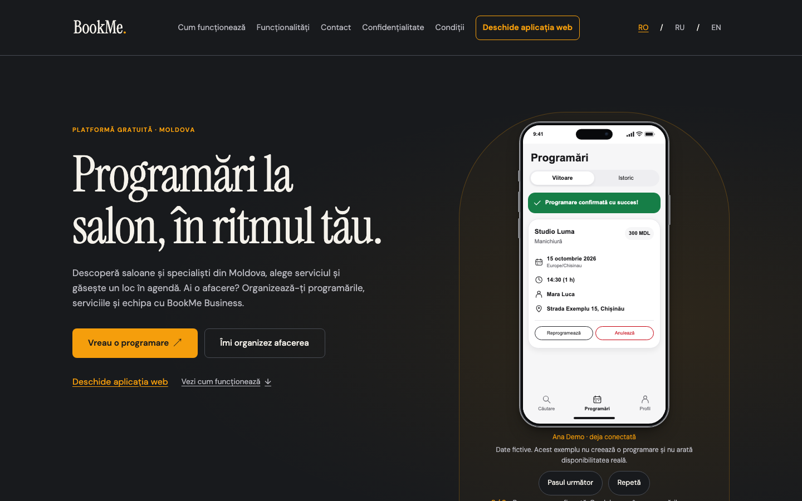
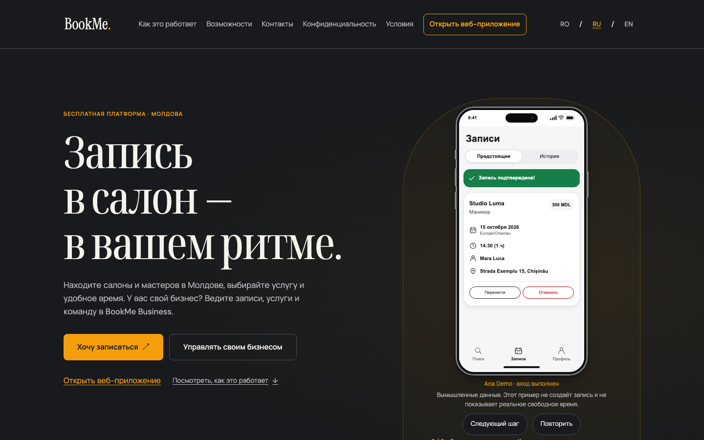
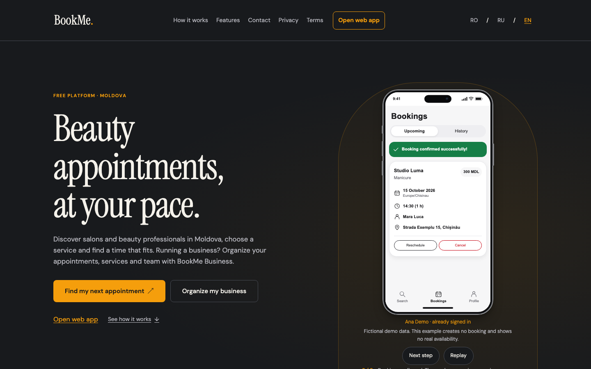

# Cyrillic typography

Ticket: [04 — Russian homepage](../../.scratch/russian-language-business-web-app/issues/04-russian-homepage.md).
DM Sans and Instrument Serif in their pinned Fontsource packages have only Latin and
Latin Extended subsets. Russian pages therefore need Cyrillic companions that keep
the graphite/orange site's character without changing Romanian or English pages.

## Choice

| Role | Latin (unchanged) | Cyrillic companion | Fontsource package | Files |
| --- | --- | --- | --- | --- |
| Text | DM Sans 400/500/600 | Manrope 400/500/600 | `@fontsource/manrope` 5.3.0 | 3 × ~7.9 KB WOFF2 |
| Headings | Instrument Serif 400 | Noto Serif Display, variable weight and width, set to 75 % width | `@fontsource-variable/noto-serif-display` 5.3.0 | 1 × 52 KB WOFF2 |

Both are SIL OFL 1.1 fonts; their license files ship as `public/licenses/manrope.txt`
and `public/licenses/noto-serif-display.txt`, next to the DM Sans and Instrument Serif
licenses. The files are bundled into `dist/_astro/` by the build. There are no Google
Fonts or other font-service requests.

Candidates were measured in Chromium against the Latin brand fonts (per em, 100 px,
on a Latin sample for the brand fonts and a Russian sample for the candidates):

| Font | x-height | Cap height | Advance per character | Ink coverage |
| --- | --- | --- | --- | --- |
| **DM Sans** (Latin reference) | 0.504 | 0.700 | 0.504 | 0.203 |
| **Manrope** | 0.540 | 0.720 | 0.512 | 0.199 |
| Commissioner | 0.500 | 0.713 | 0.500 | 0.196 |
| Onest | 0.527 | 0.707 | 0.526 | 0.208 |
| Golos Text | 0.530 | 0.700 | 0.534 | 0.212 |
| Inter | 0.546 | 0.728 | 0.538 | 0.215 |
| **Instrument Serif** (Latin reference) | 0.510 | 0.720 | 0.358 | 0.198 |
| **Noto Serif Display** (normal width) | 0.536 | 0.714 | 0.545 | 0.167 |
| Playfair Display | 0.515 | 0.708 | 0.509 | 0.178 |
| PT Serif | 0.500 | 0.700 | 0.506 | 0.196 |
| Lora | 0.500 | 0.700 | 0.526 | 0.187 |
| Prata | 0.518 | 0.800 | 0.542 | 0.187 |
| Cormorant Garamond | 0.386 | 0.625 | 0.427 | 0.118 |

- **Manrope** is a low-contrast geometric sans like DM Sans, with the closest stroke
  weight and similar proportions; Commissioner matches the x-height more closely but
  reads as humanist. Mixed lines (Cyrillic words beside `BookMe Business` or
  `support@bookme.md` in DM Sans) keep an even texture.
- **Noto Serif Display** is a high-contrast display serif with sharp wedge serifs like
  Instrument Serif. Instrument Serif is condensed (0.358 em per character), which no
  static Cyrillic candidate approaches. The variable font's width axis at 75 %
  ("Condensed") brings the Russian headings to the same narrow, tall rhythm
  (Chromium, Firefox and WebKit render the same 75 % instance: the face declares a
  single `font-stretch: 75%`, to which browsers clamp the axis). Playfair Display was
  the runner-up: close vertically, but a third wider and heavier in the headlines.

## Loading

`src/styles/cyrillic-fonts.css` declares the four faces with Fontsource's Cyrillic
range only (`U+0301, U+0400-045F, U+0490-0491, U+04B0-04B1, U+2116`). The site font
stacks are `'DM Sans', 'Manrope', sans-serif` and `'Instrument Serif', 'Noto Serif
Display', serif`: Latin text, digits and punctuation always render in the brand fonts,
and a browser downloads a Cyrillic file only when that weight renders Cyrillic text —
on Russian pages and in the Russian block of the shared 404 page. Romanian and English
pages request no new font file and look exactly as before. The Fontsource per-subset
CSS files declare no `unicode-range`, so they are not imported: without the range,
symbols such as ↗ that DM Sans lacks would make browsers download the Cyrillic files
on every page to look for them.

`tests/fonts.spec.ts` checks, in all browser projects, that `/ru/` loads both Cyrillic
files from this origin and that `document.fonts` reports them loaded for the families
used by the headings and text, and that every Romanian and English page requests and
loads no Cyrillic face.

## Review screenshots

Final production build, Chromium, `prefers-reduced-motion: reduce`, cookie notice
already acknowledged, first screen and the business section of each homepage.

| Width | Romanian | Russian | English |
| --- | --- | --- | --- |
| 320 | [hero](ro-320-hero.png), [business](ro-320-business.png) | [hero](ru-320-hero.png), [business](ru-320-business.png) | [hero](en-320-hero.png), [business](en-320-business.png) |
| 768 | [hero](ro-768-hero.png), [business](ro-768-business.png) | [hero](ru-768-hero.png), [business](ru-768-business.png) | [hero](en-768-hero.png), [business](en-768-business.png) |
| 1440 | [hero](ro-1440-hero.png), [business](ro-1440-business.png) | [hero](ru-1440-hero.png), [business](ru-1440-business.png) | [hero](en-1440-hero.png), [business](en-1440-business.png) |

  

Observations from the screenshots: the Russian headline keeps the condensed serif
silhouette and baseline rhythm of the Romanian and English headlines; body copy, buttons
and the orange eyebrow have the same weight and colour. At 320 px the longer Russian
navigation labels take one more row than Romanian, without overlap; «Открыть
веб-приложение» stays a separate full-width control below the menu, and the language
switcher stays on the logo row. Phone demos keep their own system sans-serif, as in
Romanian and English.

Regenerate after `npm run build`, with `npm run preview -- --port 4328 --ignore-lock`
running:

```sh
node scripts/capture-typography.mjs
```

## Quality results

Measured on 7 October 2026 on the final build (macOS, Node 24.20.0, the pinned Playwright
browsers and Lighthouse 12.6.1): `npm run check` 0 errors; the full `npm test` (1,744
passed, 212 intentional skips), `npm run test:consent`, `npm run test:consent-incomplete`
and `npm run test:seo` pass. Normalized gzip budgets: at most 6,551 bytes JavaScript and
8,037 bytes CSS per page (homepages, including `/ru/`), against 20,000 / 40,000.
`npm run test:lighthouse` passed all gates in 54 runs. `/ru/` scored 96 mobile / 100
desktop performance with a median LCP of 2,254 ms mobile / 524 ms desktop; the Romanian
and English pages, which load no new font, scored 98–100 with a median LCP of at most
1,655 ms. The Russian homepage
spends that margin on the 52 KB variable serif behind its headline: if it tightens, a
smaller condensed Cyrillic serif file is the lever, not a relaxed gate.

Manual acceptance of the Russian text by a native speaker or the product owner, and a
human look at these screenshots, remain pending in ticket 08.
